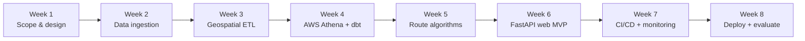
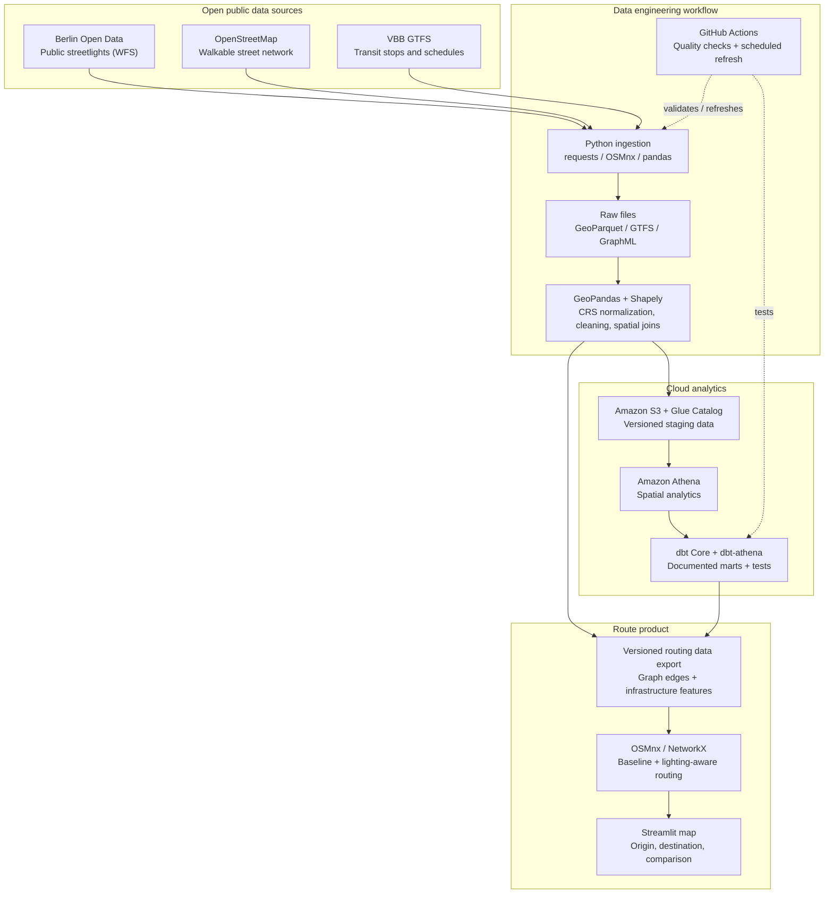
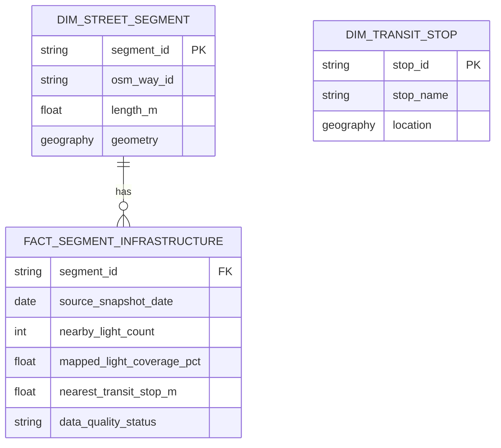
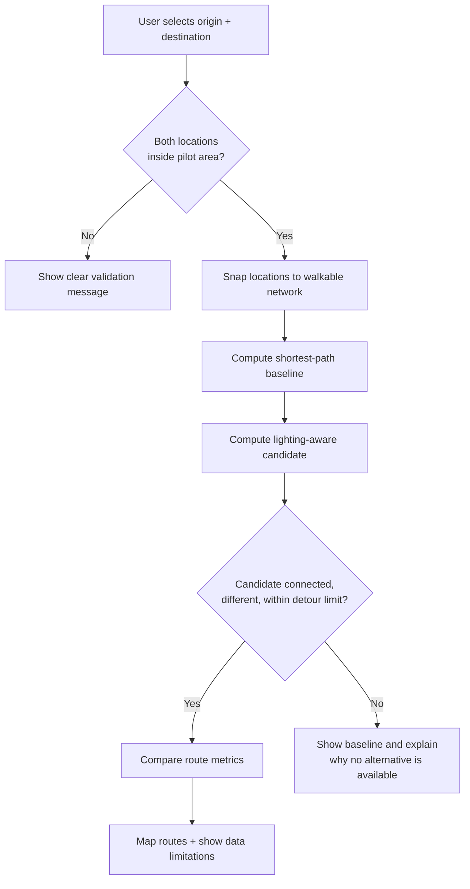
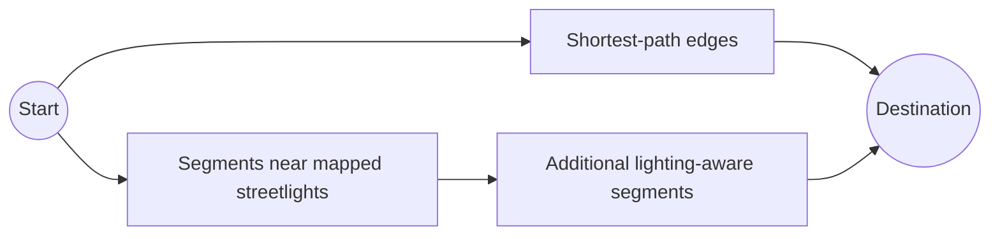
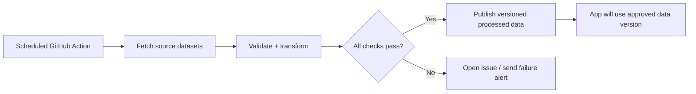

# HerRoute — Project Roadmap

> **Project status:** Phases 1–6 implemented; Phase 7 is next.
> **Working title:** HerRoute — Women's Night-Time Mobility & Urban Infrastructure Analytics  
> **Pilot location:** A limited area of **Berlin, Germany**, selected after reviewing data coverage  
> **Primary goal:** A reproducible, explainable, infrastructure-aware walking-route comparison application

> **Current status:** Phases 1–7 are implemented; Phase 8 is next.

> **Active phase (authoritative):** Phase 8 is in progress. The app is containerized for a Render free-tier public demo, uses a server-side scoped Amazon Location API key for address selection, and awaits its first live deployment and evaluation.

## Current implementation status

As of 17 November 2026, the project has completed Phases 1–6:

| Phase | Status | Evidence |
|---|---|---|
| 1. Scope and design | Complete | Requirements, architecture, assumptions, wireframe, and backlog. |
| 2. Data ingestion | Complete | Validated Berlin lighting, OSM walking-network, and VBB GTFS snapshot. |
| 3. Geospatial ETL | Complete | Tested segment features, coverage sensitivity results, and quality report. |
| 4. Cloud and modelling | Complete | Private S3, Glue, Athena, dbt models, and 19 passing cloud data tests. |
| 5. Routing algorithm | Complete | Tested shortest and lighting-aware routes, detour rejection, and two route-weight sensitivity checks. |
| 6. Interactive app | Complete | Local FastAPI web interface with AWS address suggestions, an OpenStreetMap route map, preference-aware comparisons, browser-only favourites and feedback, and copyable route links. |
| 7. Testing and automation | Complete | GitHub Actions CI, isolated candidate refresh, GitHub OIDC roles, failure issues, controlled Athena/dbt promotion, and documented recovery behaviour. |
| 8. Deployment and portfolio | In progress | Docker packaging, health endpoint, Render free-tier deployment design, and a server-side scoped AWS Location API key are ready; public deployment and evaluation remain. |

The phase plans below preserve the original scope and acceptance criteria. Actual results, technical decisions, and validation evidence are maintained in the linked project documentation.

---

## 1. Project Overview

### 1.1 Problem statement

Women who commute or walk at night may wish to compare routes not only by distance and duration, but also by the presence of mapped street lighting and access to public transport. Traditional shortest-path navigation does not always foreground these infrastructure characteristics.

**HerRoute will** combine open city data and walking-network analysis to present a shortest route and, where possible, an alternative that favors street segments with more *mapped* lighting infrastructure. The user will be able to inspect the trade-off in walking distance, estimated duration, mapped-lighting coverage, and nearby transit stops.

### 1.2 Intended users

- Students traveling home after late classes or study sessions.
- Shift workers returning home at night.
- Commuters who want more context about pedestrian infrastructure.
- Researchers interested in transparent, reproducible urban infrastructure analysis.

### 1.3 Important boundaries

> **HerRoute will not claim that a route is safe.** Public streetlight inventories do not necessarily indicate whether lights are switched on, functioning, or sufficient to illuminate the walkway. The app will describe routes as **lighting-aware**, **better covered by mapped lighting infrastructure**, or **better connected to transit**—not as guaranteed safe routes. It will show data freshness and coverage limitations.

HerRoute will not use crime predictions, user location history, or personal profiles in the MVP. A route comparison will be calculated from the selected start and end locations, without persistent storage of personal journeys.

### 1.4 MVP features that will be built

- The user **will** select a start and destination within the Berlin pilot area.
- The application **will** display a conventional shortest walking route.
- It **will** calculate an infrastructure-aware alternative **when feasible**.
- It **will** show each route's distance and estimated walking time.
- It **will** show estimated street-segment coverage by *mapped streetlights* and transit-stop proximity.
- It **will** expose the assumptions used to estimate coverage, along with missing-data warnings.
- It **will** use open-source Python tooling and a small AWS analytics layer.
- It **will** include automated data validation, tests, documentation, and a public demo.

### 1.5 Features that will not be built in the initial MVP

Real-time lamp operational status, predictive personal-safety scores, real-time transit arrival tracking, native iOS/Android apps, country-wide routing, personal user accounts, and journey-history storage **will be deferred**.

---

## 2. Time & Effort Estimate

| Phase | Week | Estimated effort | Planned outcome |
|---|---:|---:|---|
| 1. Scope & design | 1 | 8–10 h | Requirements, scope, architecture, wireframes |
| 2. Data ingestion | 2 | 10–12 h | Repeatable ingestion of three public data sources |
| 3. Geospatial ETL | 3 | 12–14 h | Clean network and segment-level infrastructure metrics |
| 4. Cloud & modelling | 4 | 10–12 h | Tested AWS Athena and dbt analytical models |
| 5. Routing algorithm | 5 | 16–20 h | Shortest-path and lighting-aware route comparison |
| 6. Interactive app | 6 | 12–15 h | Functional local FastAPI web demo |
| 7. Testing & automation | 7 | 12–15 h | Automated tests, CI, scheduled data-refresh workflow |
| 8. Deployment & portfolio | 8 | 10–12 h | Public demo, evaluation, README and case study |
| **Total** | **8 weeks** | **90–110 h** | **Portfolio-ready MVP** |

**Alternative pacing:** At 5–7 hours per week, the same work will likely take about **12–16 weeks**. One additional contingency week **will be reserved** if external datasets or geospatial routing present unexpected difficulties.

### 2.1 Visual phase roadmap



### 2.2 Major milestones

| Target | Milestone | Acceptance evidence that will be produced |
|---|---|---|
| **End of Week 2** | Data acquisition | Fresh execution downloads and saves valid datasets |
| **End of Week 4** | Data engineering | Tested geospatial features + reproducible warehouse models |
| **End of Week 5** | Routing prototype | Both route algorithms run on pilot-area test cases |
| **End of Week 6** | Functional MVP | A user can compare routes through the local UI |
| **End of Week 8** | Public release | Deployed demo, evaluation, technical README, and case study |

---

## 3. Target Architecture

The application **will separate batch data preparation from interactive route calculation**. Heavy GIS joins and data cleaning will be done during data preparation, not every time a user requests a route.



**Planned stack**

| Layer | Tool | Why it will be used |
|---|---|---|
| Source retrieval | Python, `requests`, OSMnx, pandas | Public data ingestion |
| Spatial transformation | GeoPandas, Shapely, PyProj | Geometries, distances, joins, validation |
| Storage | Local GeoParquet / GraphML | Low-cost, reproducible source and routing artifacts |
| Cloud analytics | Amazon S3, AWS Glue Data Catalog, Amazon Athena | Low-operational-overhead storage, cataloging and spatial queries |
| Analytics engineering | dbt Core + dbt-athena | Reusable models, tests, metric definitions and documentation |
| Routing | NetworkX / OSMnx | Graph-based pathfinding |
| UI | FastAPI, vanilla JavaScript, Leaflet | Browser route comparison, address selection, and map overlays |
| Automation | GitHub Actions | CI and scheduled refreshes |
| Packaging | Docker | Reproducible local environment |
| Deployment | Docker + Render free web service | Remote container build for a portfolio demo; may sleep when idle |

---

## 4. Phase-by-Phase Implementation Plan

### Phase 1 — Problem Definition & System Design

**When:** Week 1  
**Estimated effort:** 8–10 hours  
**Objective:** The user problem, target area, MVP scope, data requirements and technical boundaries **will be defined**.

**Work to be done**

- [ ] Write a one-page problem statement and identify intended users.
- [ ] Choose a small Berlin pilot area after checking streetlight, pedestrian and transit-data coverage.
- [ ] Define the precise MVP journey: input two locations → calculate alternatives → view route metrics → interpret limitations.
- [ ] Define key indicators: walking distance, estimated time, mapped-lighting coverage, transit-stop proximity, data completeness.
- [ ] Sketch the user interface, including route selection, map, legend, comparison and warnings.
- [ ] Define the data schema, architecture and the separation between batch processing and route requests.
- [ ] Establish project scope, assumptions, ethical safeguards and success criteria.
- [ ] Create the GitHub repository, issue board and initial folders.

**Artifacts that will be created:** `docs/requirements.md`, `docs/architecture.md`, `docs/assumptions.md`, UI wireframe, issue backlog.

**Definition of done:** A reader will be able to identify the core function, required datasets, technical approach, and what the MVP will **not** claim.

### Phase 2 — Data Discovery & Ingestion

**When:** Week 2  
**Estimated effort:** 10–12 hours  
**Objective:** Public streetlighting, walking-network and transit data **will be downloaded and saved** reproducibly.

**Primary datasets**

| Dataset | Planned content | Access/reference |
|---|---|---|
| Berlin Open Data — Public Lighting | Public streetlight inventory and coordinates | [Berlin Public Lighting WFS](https://daten.berlin.de/datensaetze/offentliche-beleuchtung-wfs-77fc5415) |
| OpenStreetMap | Walkable streets, footways, crossings, intersections | [OpenStreetMap](https://www.openstreetmap.org/) and [OSMnx](https://osmnx.readthedocs.io/) |
| VBB public transport | Static stop locations and scheduled transport data | [VBB datasets](https://unternehmen.vbb.de/en/digital-services/datasets/) |

**Work to be done**

- [ ] Confirm dataset licence and attribution requirements.
- [ ] Confirm geographic bounds, available fields, date stamps and coordinate reference systems (CRS).
- [ ] Write Python ingestion modules for streetlights, OSM walking graph and VBB GTFS.
- [ ] Select and save only the pilot-region data needed for the MVP.
- [ ] Persist raw outputs in appropriate formats (`.parquet`, `.gpkg`, `.graphml`, GTFS zip/CSV as applicable).
- [ ] Record source URLs, collection timestamps and data versions.
- [ ] Implement basic source checks: files exist, shapes parse, geometries are present, and coordinates fall within reasonable bounds.
- [ ] Make the ingestion repeatable without manual editing or copying.

**Artifacts that will be created:** `src/ingestion/`, `data/raw/` (or instructions to regenerate non-versioned large files), `docs/data_sources.md`, ingestion validation logs.

**Definition of done:** A clean local execution will reproduce all three raw inputs for the selected area.

### Phase 3 — Geospatial Data Processing

**When:** Week 3  
**Estimated effort:** 12–14 hours  
**Objective:** Raw geospatial data **will be transformed** into trusted street-segment infrastructure features.

**Work to be done**

- [ ] Validate and standardize geometry columns and CRS.
- [ ] Convert relevant geometries to a projected coordinate system before measuring distances.
- [ ] Remove duplicate, invalid or out-of-bound geometries.
- [ ] Build or clean the pedestrian network; check graph connectivity.
- [ ] Calculate segment lengths in metres.
- [ ] Spatially associate mapped lights with nearby walking segments.
- [ ] Create a transparent **heuristic** for mapped-lighting coverage and retain counts or densities alongside it.
- [ ] Associate street segments with nearest transit-stop proximity.
- [ ] Label missing inputs explicitly rather than converting missing data to zero coverage.
- [ ] Export processed GIS artifacts for analytics and routing.

**Initial modelling assumption:** A street segment section within **20 m** of a mapped light could be marked as *near mapped lighting infrastructure*. This radius **will be tested for sensitivity**; it will **not** represent a scientifically validated illumination radius.

**Illustrative output schema (not real results)**

| `segment_id` | `length_m` | `mapped_light_coverage_pct` | `nearest_transit_stop_m` | `data_quality_status` |
|---|---:|---:|---:|---|
| A01 | 120 | 85 | 190 | complete |
| A02 | 200 | 40 | 480 | complete |
| A03 | 95 | 100 | 75 | complete |

**Artifacts that will be created:** `src/geospatial/`, cleaned nodes/edges, segment-level features, reproducibility notes, data quality report.

**Definition of done:** Each eligible pilot-region segment will have a validated geometric length, a documented lighting proxy and transit proximity where source data allow.

### Phase 4 — AWS Athena & dbt Analytics Engineering

**When:** Week 4  
**Estimated effort:** 10–12 hours  
**Objective:** Cloud-hosted analytical tables and documented, tested models **will be created**.

**Work to be done**

- [ ] Create an AWS project boundary, least-privilege IAM roles, S3 buckets/prefixes, Glue database and Athena workgroup; configure AWS Budgets, alerts and Athena scan limits.
- [ ] Load cleaned geospatial features into versioned S3 staging prefixes and register them in the Glue Data Catalog.
- [ ] Define Athena-compatible geospatial representations and validate coordinate order and geometry conversions.
- [ ] Create dbt-athena staging and mart models.
- [ ] Define and document table grains and relationships.
- [ ] Add tests for unique IDs, non-null required columns, ranges, valid geometries and key relationships.
- [ ] Produce summary queries by segment and pilot-area subdivision.
- [ ] Export a versioned feature dataset for the interactive route engine.
- [ ] Run and document a clean rebuild.

**Planned analytical model**



`DIM_TRANSIT_STOP` will be available for proximity analysis; it will not require a fabricated one-to-one relationship with a street segment.

**Artifacts that will be created:** `dbt/`, S3/Glue/Athena resources, model documentation, test results, schema diagram, sample queries.

**Definition of done:** A full run will rebuild analytics marts and pass required data-quality checks.

### Phase 5 — Routing Algorithm & Route Comparison

**When:** Week 5  
**Estimated effort:** 16–20 hours  
**Objective:** Baseline and lighting-aware alternatives **will be calculated**, compared, and validated.

**Work to be done**

- [ ] Represent the walkable network as a weighted graph.
- [ ] Implement shortest-path routing by segment distance (Dijkstra or equivalent tested method).
- [ ] Map precomputed lighting features onto graph edges.
- [ ] Define an explainable lighting-aware cost function that penalizes segments with sparse mapped lighting.
- [ ] Add a detour constraint; a **20% additional-distance limit** will be tested as an initial parameter.
- [ ] Generate a meaningful alternative only when a distinct feasible route exists.
- [ ] Compare distance, approximate duration, mapped-lighting coverage and transit proximity.
- [ ] Handle disconnected graphs, invalid points, identical routes, and unknown source coverage.
- [ ] Test sensitivity to coverage-buffer radius and algorithm weights.

**Route-calculation logic**



**Schematic example — not real Berlin geography**



**Illustrative comparison — not a forecast or measured result**

| Metric | Shortest route | Lighting-aware route |
|---|---:|---:|
| Distance | 1.4 km | 1.6 km |
| Estimated time | 18 min | 21 min |
| Estimated mapped-light coverage | 42% | 78% |

**Artifacts that will be created:** `src/routing/`, route-cost documentation, tests, reproducible route-comparison examples.

**Definition of done:** The routing engine will provide valid baseline and alternative paths for representative locations, while reporting when no alternative can be justified.

### Phase 6 — Interactive Streamlit Application

**When:** Week 6  
**Estimated effort:** 12–15 hours  
**Objective:** A user-facing local application **will be implemented**.

**Work to be done**

- [ ] Build origin and destination input controls for the pilot area.
- [ ] Render a street map with two route overlays (where an alternative exists).
- [ ] Add a compact route comparison panel.
- [ ] Show mapped streetlight coverage, walking distance, duration and nearby transit information.
- [ ] Add map legend, methodology explanation, source attribution and last-updated details.
- [ ] Explain the difference between *streetlight inventory* and *actual night-time illumination*.
- [ ] Provide feedback for invalid input, unavailable segments and missing data.
- [ ] Cache read-only processed network artifacts for acceptable response time.
- [ ] Test navigation and layout from a non-technical user's perspective.

**Planned UI wireframe**

```text
+--------------------------------------------------------------+
| HerRoute | Night-Time Walking Infrastructure Explorer         |
+-------------------------+------------------------------------+
| Origin: [____________]  |                                    |
| Destination: [_______]  |   Interactive street map           |
| [Compare walking routes]|   - shortest-path overlay          |
|                         |   - lighting-aware overlay         |
| Shortest route          |   - start / end markers            |
| - distance / minutes    |   - mapped infrastructure legend   |
| - mapped-light coverage |                                    |
|                         |                                    |
| Lighting-aware route    |                                    |
| - distance / minutes    |                                    |
| - mapped-light coverage |                                    |
|                         |                                    |
| [Data limitations]      |                                    |
+-------------------------+------------------------------------+
| Source attribution | Data freshness | Methodology             |
+--------------------------------------------------------------+
```

**Artifacts that will be created:** `app/`, map components, route comparison panel, documented UI decisions.

**Definition of done:** An unfamiliar tester will be able to enter endpoints, display route alternatives and understand the displayed values.

### Phase 7 — Quality, CI/CD & Automated Refresh

**When:** Week 7  
**Estimated effort:** 12–15 hours  
**Objective:** The pipeline and application **will be maintainable, testable and reproducible**.

**Work to be done**

- [ ] Add unit tests for geometry transformations, edge weighting and route comparison.
- [ ] Add data checks for duplicate IDs, invalid geometry and missing source fields.
- [ ] Add deterministic routing regression cases for selected pilot-area endpoints.
- [ ] Add GitHub Actions CI for linting and tests on push / pull request.
- [ ] Add scheduled source refresh workflows, only as often as justified by source-update frequency.
- [ ] Add retry / fail-fast handling and failure logging.
- [ ] Add a notification path such as GitHub issues or email on pipeline failures.
- [ ] Record freshness metadata and ensure dataset changes do not silently break the app.
- [ ] Verify the app can run from a clean checkout or Docker environment.

**Planned automation flow**



**Artifacts that will be created:** `tests/`, `.github/workflows/`, environment setup instructions, alerting specification, fresh-data metadata.

**Definition of done:** Changes will trigger tests automatically, refreshes will be reproducible, and broken data will not silently replace valid application data.

### Phase 8 — Deployment, Evaluation & Portfolio Release

**When:** Week 8  
**Estimated effort:** 10–12 hours  
**Objective:** A public, documented, evaluated MVP **will be released**.

**Work to be done**

- [x] Package the FastAPI application as a Docker image, with a health endpoint and a scoped server-side Places API-key option.
- [ ] Deploy the FastAPI application to Render's free web-service tier.
- [ ] Check external access, resource consumption and response time.
- [ ] Evaluate **20–30** start/end pairs within the pilot region.
- [ ] Compare baseline and alternative route outcomes.
- [ ] Record cases where alternatives are impossible, data are incomplete, or assumptions affect the result.
- [ ] Report route computation latency and percentage of valid requests handled.
- [ ] Write a README with screenshots, architecture, datasets, reproducibility steps and limitations.
- [ ] Add a short video/GIF demo and a portfolio case study.
- [ ] Add the finished project's GitHub and demo links to the personal portfolio and CV **only after those links exist**.

**Evaluation measures that will be reported**

- Median and distribution of extra distance for lighting-aware alternatives.
- Difference in estimated mapped-light coverage across route pairs.
- Proportion of requested journeys with a distinct alternative.
- Route-calculation runtime under representative conditions.
- Number and type of failed validations or missing-data cases.
- Sensitivity to buffer radius and route-weight choices.

**Artifacts that will be created:** Public app URL, final README, evaluation results, screenshots, demo, limitations, portfolio case study.

**Definition of done:** A recruiter will be able to launch the public demo, inspect the code and methodology, and see measured project results.

---

## 5. Repository Structure (Planned)

```text
herroute/
├── README.md
├── ROADMAP.md
├── requirements.txt
├── pyproject.toml               # if selected for package management
├── Dockerfile
├── .gitignore
├── .github/
│   └── workflows/
│       ├── ci.yml
│       └── refresh_data.yml
├── app/
│   ├── streamlit_app.py
│   └── components/
├── src/
│   ├── ingestion/
│   ├── geospatial/
│   ├── routing/
│   └── common/
├── dbt/
│   ├── models/
│   │   ├── staging/
│   │   └── marts/
│   └── tests/
├── tests/
├── data/
│   ├── raw/                    # large files may stay untracked
│   ├── processed/              # generated; selected samples may be tracked
│   └── sample/
├── notebooks/
├── docs/
│   ├── requirements.md
│   ├── architecture.md
│   ├── data_sources.md
│   ├── methodology.md
│   ├── assumptions.md
│   └── evaluation.md
└── assets/
    ├── screenshots/
    └── demo/
```

No repository file listed above should be described as already implemented until it is created.

---

## 6. Full Implementation Checklist

### Week 1 — Scope
- [ ] Write problem statement and define MVP.
- [ ] Choose Berlin pilot area.
- [ ] Create architecture, assumptions and data requirements.

### Week 2 — Data
- [ ] Retrieve streetlighting and walking-network data.
- [ ] Retrieve transit-stop information.
- [ ] Build repeatable ingestion scripts.

### Week 3 — GIS
- [ ] Clean and standardize geometries.
- [ ] Join streetlights to street segments.
- [ ] Calculate infrastructure features.

### Week 4 — Cloud
- [ ] Create S3 staging storage, Glue tables and Athena workgroup.
- [ ] Develop dbt models.
- [ ] Add SQL/data-quality tests.

### Week 5 — Routing
- [ ] Implement shortest-path baseline.
- [ ] Develop lighting-aware weights.
- [ ] Compare and validate alternative routes.

### Week 6 — Application
- [ ] Build location inputs and map.
- [ ] Show route metrics and overlays.
- [ ] Add error handling and data limitations.

### Week 7 — Automation
- [ ] Add automated tests.
- [ ] Configure GitHub Actions.
- [ ] Set up scheduled data-refresh monitoring.

### Week 8 — Release
- [ ] Run evaluation scenarios.
- [ ] Deploy application.
- [ ] Publish README, demonstration and portfolio case study.

---

## 7. Cost Control Plan

**Target:** The MVP **will be designed** to operate within approximately **€0–€5/month**, but platform limits and pricing **will be verified** before deployment. Cloud budgets/alerts will be configured; a budget alert alone does not always enforce a hard spending cap.

| Service | Planned usage | Cost-control approach |
|---|---|---|
| Python, GeoPandas, OSMnx, NetworkX, dbt Core, DuckDB | Local data processing and algorithms | Free/open-source; run locally |
| Amazon S3, Glue Data Catalog, Athena | Cloud spatial analytics | Small pilot area, partitioned/versioned files, lifecycle policy, Athena workgroup scan limits and AWS Budgets |
| GitHub Actions | Tests and scheduled refresh | Modest run cadence, cache dependencies when helpful |
| Streamlit Community Cloud | Host demo | Use free offering within resource constraints |
| Geocoding/routing APIs | Avoid paid requests where possible | Prefer local OSM network and clearly documented geocoding limits |

AWS service pricing, Free Tier terms and regional availability **will be checked at setup time**: [AWS Pricing](https://aws.amazon.com/pricing/). Hosting terms **will be checked** at [Streamlit Community Cloud](https://streamlit.io/cloud).

**Rules that will be followed:** No always-on VM, no paid database cluster, no unbounded query loops, no storing personal route histories, and no hardcoded credentials.

---

## 8. Evaluation & Quality Criteria

The completed project **will be assessed** on the following criteria rather than simply on whether a map renders.

| Dimension | Evidence that will be produced |
|---|---|
| Data reliability | Source timestamps, reproducible ingestion and validation checks |
| Geospatial correctness | CRS validation, segment length tests and spatial-join tests |
| Routing correctness | Baseline shortest paths, graph connectivity tests and known test cases |
| Explainability | Explicit route-cost formula and documented parameters |
| Meaningful comparison | Measured detour vs mapped-light coverage trade-offs |
| Responsiveness | Route calculation times across test journeys |
| Reproducibility | Clean setup instructions, lock/pinned dependencies and CI |
| Responsible presentation | Missing-data indicators, methodology and limitations |
| Portfolio readiness | Public demo, screenshots, architecture and evaluation write-up |

**No target improvement percentage will be presented as an achieved result before it is measured.**

---

## 9. Risks, Assumptions & Mitigations

| Risk | Potential effect | Planned mitigation |
|---|---|---|
| Streetlight data do not capture actual light conditions | Misleading interpretation | Label as mapped infrastructure; explain lack of real-time illumination data |
| Incomplete OSM footpaths or disconnected edges | Invalid routes | Validate graph connectivity, reject unreachable endpoints, report limitations |
| Uncertain 20 m buffer and route weights | Arbitrary coverage estimates | Sensitivity testing and transparent methodology |
| Differing source update schedules | Stale or inconsistent data | Source-specific refreshes and displayed timestamps |
| Cloud fees | Unexpected expense | Small geographic extent, budgets/alerts, local preprocessing |
| Slow route response | Poor UX | Precompute features, cache graphs and limit pilot area |
| No meaningful alternative route | Unhelpful two-route display | Show one route and explain why an alternative is unavailable |
| Timeline slips in GIS/routing | Delayed release | Prioritize usable baseline, keep feature scope narrow, reserve contingency |

---

## 10. Future Enhancements (Post-MVP)

The following **may be considered after** the evaluated MVP is released:

- An additional German pilot city using comparable open data.
- Pedestrian accessibility attributes, including step-free routes where mapped data support them.
- An infrastructure-gap dashboard for city planning rather than individual routing.
- More sophisticated uncertainty reporting and source-quality scoring.
- User research or feedback sessions conducted without storing sensitive journey histories.
- An optional standalone frontend if a dedicated React or mobile experience later proves useful.

The roadmap **will not prioritize crime-risk scores or claims of personal safety** from inadequate proxies.

---

## 11. Useful Documentation & Data Links

### Data sources

1. [Berlin Open Data — Public Street Lighting (WFS)](https://daten.berlin.de/datensaetze/offentliche-beleuchtung-wfs-77fc5415)
2. [OpenStreetMap](https://www.openstreetmap.org/)
3. [VBB Digital Services — Public Datasets / GTFS](https://unternehmen.vbb.de/en/digital-services/datasets/)

### Geospatial and routing tools

4. [OSMnx documentation](https://osmnx.readthedocs.io/)
5. [GeoPandas documentation](https://geopandas.org/en/stable/)
6. [Shapely documentation](https://shapely.readthedocs.io/)
7. [NetworkX shortest-path algorithms](https://networkx.org/documentation/stable/reference/algorithms/shortest_paths.html)
8. [Folium documentation](https://python-visualization.github.io/folium/)

### Cloud, analytics and deployment

9. [Amazon Athena documentation](https://docs.aws.amazon.com/athena/)
10. [AWS Pricing](https://aws.amazon.com/pricing/)
11. [dbt Core documentation](https://docs.getdbt.com/docs/core/installation-overview)
12. [GitHub Actions documentation](https://docs.github.com/en/actions)
13. [Streamlit documentation](https://docs.streamlit.io/)
14. [Streamlit Community Cloud](https://streamlit.io/cloud)
15. [Mermaid diagram syntax for GitHub-compatible Markdown](https://mermaid.js.org/intro/)

---

## 12. Planned Portfolio / CV Description (Use Only After Implementation)

**Project name:** HerRoute — Women's Night-Time Mobility Infrastructure Analytics  
**Planned technologies:** Python, GeoPandas, OSMnx, NetworkX, Amazon S3, AWS Glue Data Catalog, Amazon Athena, dbt Core, SQL, Streamlit, GitHub Actions, Docker

**Candidate bullet — to be finalized against actual results:**

> Will develop a cloud-supported geospatial application integrating public streetlighting, walking-network and transit data; will build reproducible Python ETL pipelines, tested spatial analytics models and an explainable routing engine to compare shortest and lighting-aware walking routes.

After completion, this future-tense planning bullet **will be replaced** with an accurate past-tense CV achievement containing verified metrics such as route-evaluation count, computation latency, test coverage, data volume or observed route trade-offs.

---

## 13. Project Release Gate

The HerRoute MVP **will be declared complete only when** all of the following have been demonstrated:

- [ ] An unfamiliar user can successfully request a route within the pilot region.
- [ ] The baseline shortest path is validated.
- [ ] An alternative is returned when feasible, with transparent constraints.
- [ ] Mapped-lighting coverage is documented as a proxy, not a safety guarantee.
- [ ] Public data sources, dates, assumptions and limitations are visible.
- [ ] Geospatial data transformations and routing logic pass tests.
- [ ] Processing and model builds are reproducible.
- [ ] CI is operational and the data refresh process is documented.
- [ ] A public demo and project documentation are accessible.
- [ ] Evaluation results are published with actual—not illustrative—numbers.

**Status at roadmap creation:** All items above are planned, not completed.
