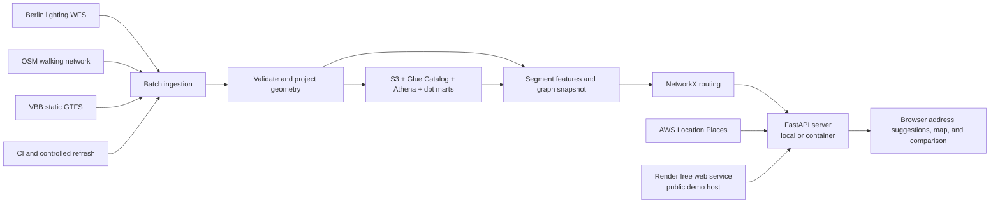

# Architecture and contracts

Status: Phases 1–7 are complete. Phase 8 public-demo deployment is in progress. AWS analytics, local route comparisons, a FastAPI browser interface, container packaging, and controlled refresh/promotion are implemented. The route engine intentionally reads the matching local snapshot; warehouse promotion does not change it.

Batch processing handles network acquisition, projection, spatial joins and validation. The interactive app loads a matching graph and feature snapshot and performs routing only. AWS Location Places supplies live address suggestions, while the browser loads OpenStreetMap tiles for display. Favourites and feedback stay in browser local storage and are never sent to the server. The public-demo container receives the two routing artifacts from the versioned `data/release/` snapshot, but no AWS account credentials and no warehouse data-access permissions. Its server-side Amazon Location API key is limited to autocomplete and place retrieval. The warehouse and its export are separately reproducible. A release manifest binds artifacts to a snapshot and records provenance and validation status.

## Proposed data contracts

| Dataset | Grain and required fields | Notes |
|---|---|---|
| Source manifest | One entry per source snapshot: source URL, retrieved UTC timestamp, source version/date if available, license, bounds, checksum | Unknown source dates are explicitly unknown. |
| Network nodes | OSM node ID, coordinates | Geographic coordinates for display, projected geometry for metric operations. |
| Network edges | Directed multigraph key `(u, v, key)`, stable snapshot segment ID, geometry, length in metres | Do not assume OSM way ID uniquely identifies an edge. Retain direction and parallel edges. |
| Lights | Source identifier if available, point geometry, snapshot | Validate fields and source completeness before assigning known coverage. |
| Transit stops | GTFS stop ID, name, point geometry, snapshot | Stop proximity does not imply operating service. |
| Segment features | Snapshot ID, segment ID, length, known covered length, unknown length, light count, nearest stop distance or null, quality status | Percentages derive from eligible lengths; null means unknown, not zero. |
| Route result | Ordered edge IDs, distance, duration, covered and unknown lengths, documented transit metric, snapshot ID | No persistent user journey storage. |

Use a suitable Berlin metric CRS, initially EPSG:25833, for distances and spatial joins; convert to WGS84 for display and Athena geospatial processing. Preserve source CRS and validate transformations. Schema details and stop-distance aggregation will be finalized against actual source data in later phases.

## Data quality and operational boundaries

AWS stores versioned feature artifacts in S3, registers them in the AWS Glue Data Catalog, queries them with Athena, and models them with dbt using an Athena adapter. The current project uses a restricted operator role, S3 encryption and lifecycle settings, an Athena scan limit, and AWS Budget alerts. Validate geometry, bounds, IDs, graph connectivity, coverage ranges, referential integrity and artifact snapshot consistency. Build candidate snapshots separately and only promote after checks pass; preserve the last valid version. Record failures and freshness without logging endpoints. CI uses small deterministic fixtures; actual source refresh cadence follows provider updates and service terms.
