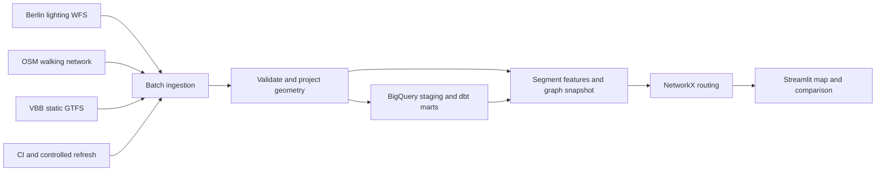

# Architecture and contracts

Status: proposed design. No component is deployed.

Batch processing handles network acquisition, projection, spatial joins and validation. The interactive app loads a matching graph and feature snapshot and performs routing only. The local app must remain usable without a live warehouse connection; the warehouse and its export are separately reproducible. A release manifest binds all artifacts to the same snapshot and records provenance and validation status.

## Proposed data contracts

| Dataset | Grain and required fields | Notes |
|---|---|---|
| Source manifest | One entry per source snapshot: source URL, retrieved UTC timestamp, source version/date if available, license, bounds, checksum | Unknown source dates are explicitly unknown. |
| Network nodes | OSM node ID, coordinates | Geographic coordinates for display, projected geometry for metric operations. |
| Network edges | Directed multigraph key `(u, v, key)`, stable snapshot segment ID, geometry, length in metres | Do not assume OSM way ID uniquely identifies an edge. Retain direction and parallel edges. |
| Lights | Source identifier if available, point geometry, snapshot | Validate fields and source completeness before assigning known coverage. |
| Transit stops | GTFS stop ID, name, point geometry, snapshot | Stop proximity does not imply operating service. |
| Segment features | Snapshot ID, segment ID, length, known covered length, unknown length, light count, nearest stop distance or null, quality status | Percentages derive from eligible lengths; null means unknown, not zero. |
| Route result | Ordered edge IDs, distance, duration, covered and unknown lengths, documented transit metric, snapshot ID | No persistent user journey storage. |

Use a suitable Berlin metric CRS, initially EPSG:25833, for distances and spatial joins; convert to WGS84 for display and BigQuery geography. Preserve source CRS and validate transformations. Schema details and stop-distance aggregation will be finalized against actual source data in later phases.

## Data quality and operational boundaries

Validate geometry, bounds, IDs, graph connectivity, coverage ranges, referential integrity and artifact snapshot consistency. Build candidate snapshots separately and only promote after checks pass; preserve the last valid version. Record failures and freshness without logging endpoints. CI uses small deterministic fixtures; actual source refresh cadence follows provider updates and service terms. No billing, service credentials or public infrastructure is created in this phase.
