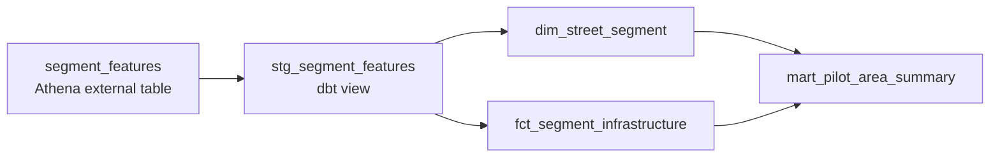

# AWS analytics layer

HerRoute uses a private, low-operations AWS warehouse in `eu-central-1` (Frankfurt): Amazon S3 stores versioned prepared inputs, AWS Glue Data Catalog stores metadata, Amazon Athena runs SQL, and dbt builds documented staging and mart models.

## Cost and access boundaries

- The AWS account’s promotional credits automatically offset eligible charges while credits remain. The `herroute-monthly-cost` budget sends alerts at 50%, 80%, and 100% of a US$5 monthly gross-cost threshold, so consumption remains visible even when credits apply.
- The Athena workgroup has a 1 GiB scan limit per query, an enforced encrypted result location, and no public S3 access.
- Use the local `herroute` AWS CLI profile. It assumes the `HerRouteOperator` role; do not run project operations with the root profile. The role can access only the HerRoute bucket, Glue database/tables, and Athena workgroup.
- S3 versioning, default SSE-S3 encryption, public-access blocking, and lifecycle cleanup for noncurrent versions are enabled on the project bucket.

A budget is an alerting mechanism. It is not a complete spend stop, so keep Athena queries small and use the `herroute` workgroup.

## Provisioned resources

| Service | Resource | Verified configuration |
|---|---|---|
| IAM | `HerRouteOperator` role | Assumed through the local `herroute` profile; its policy is restricted to the project bucket, Glue catalog/database/tables, and Athena workgroup. |
| S3 | Private HerRoute bucket | Public access is blocked; versioning and default SSE-S3 encryption are enabled. |
| Glue | `herroute` database | Catalog for the uploaded source and dbt-built relations. |
| Athena | `herroute` workgroup | Enforced encrypted results path and 1 GiB scan cutoff per query. |
| AWS Budgets | `herroute-monthly-cost` | Monthly US$5 gross-cost budget with alerts at 50%, 80%, and 100%. |

## Snapshot layout

```text
s3://herroute-627511992462-eu-central-1/
  staging/segment_features/snapshot=2026-11-17/
    manifest.json
    data/segment_features.parquet
  warehouse/                         # requested dbt table-data prefix
  athena-results/                    # encrypted query results
```

Only files under `data/` are exposed to the external Athena table. The manifest stays adjacent to the snapshot for provenance without being scanned as Parquet.

## Load and model a snapshot

From the repository root, activate the virtual environment and select the restricted profile:

```powershell
$env:AWS_PROFILE = 'herroute'
$env:HERROUTE_ATHENA_RESULTS = 's3://herroute-627511992462-eu-central-1/athena-results/'
$env:HERROUTE_WAREHOUSE = 's3://herroute-627511992462-eu-central-1/warehouse/'
.venv\Scripts\python -m src.warehouse.export
```

The initial table DDL and location-change SQL reflect the approved 2026-11-17 snapshot. Subsequent updates use the reviewed `Promote approved candidate` workflow, which revalidates a candidate, copies it to a new immutable staging prefix, changes the Athena source location, and runs `dbt build`.

Set up dbt without committing credentials:

```powershell
Copy-Item dbt\profiles.yml.example $HOME\.dbt\profiles.yml
Set-Location dbt
..\.venv\Scripts\dbt debug
..\.venv\Scripts\dbt build
```

The input table has one row per directed walking-network segment. The models then create:

| Model | Grain | Purpose |
|---|---|---|
| `stg_segment_features` | segment and snapshot | Typed source fields with WKT geometry, validated through Athena spatial functions. |
| `dim_street_segment` | segment and snapshot | Stable graph identity, geometry, and length. |
| `fct_segment_infrastructure` | segment and snapshot | Lighting and transit-proximity measures. |
| `mart_pilot_area_summary` | snapshot | Pilot-wide length and mapped-lighting coverage summary. |



`dbt build` runs unique, non-null, relationship, coverage-range, nonnegative-distance, and WKT geometry checks. The enforced Athena workgroup output location takes precedence over adapter table-location settings, so Athena may write dbt table data beneath `athena-results/`; this remains inside the private, encrypted project bucket.

## Verified first build

On 15 November 2026, the first `dbt build` completed successfully against the validated segment snapshot: 3 table models, 1 staging view, 1 raw source, and 19 data tests passed. The source contained 19,516 directed walking-network segments. Athena also confirmed that every exported WKT value parsed as an `ST_LineString`.

| Check | Result |
|---|---:|
| Raw source required-field and unique-ID checks | 5 passed |
| dbt model tests | 14 passed |
| dbt models built | 4 of 4 |
| WKT geometries Athena could not parse | 0 |
| Mean source-segment mapped-light coverage proxy | 76.24% |

## Public-demo AWS boundary

The public demo does not connect to this warehouse. Its host receives only a scoped Amazon Location API key for `geo-places:Autocomplete` and `geo-places:GetPlace` on `arn:aws:geo-places:eu-central-1::provider/default`. The key supports address selection and is stored as a host secret; it grants no S3, Glue, Athena, dbt, IAM, or warehouse access. This separates a low-cost public route demonstration from analytical data-management permissions.

## Approved warehouse snapshot: 17 November 2026

The manual candidate-refresh workflow produced candidate `run-44127441145-1`. Its manifest records 7,860 walking-network nodes, 19,524 directed segments, 4,759 mapped-light points, and 912 transit stops. The reviewed promotion workflow revalidated the candidate artifacts, activated `staging/segment_features/snapshot=2026-11-17/data/` as the Athena external-table location, then rebuilt and tested the dbt models successfully. This is the current approved warehouse source. The local FastAPI routing snapshot is separate and was not changed by warehouse promotion.
